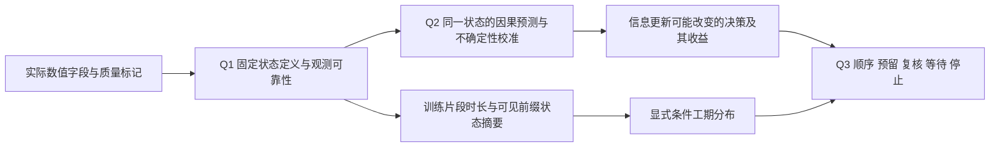

# C 题独立读题与决策记录（2026-11-20）

> **实施状态更新**：用户已回答模型选择问题并明确要求实施；随后要求优先产出第一问。当前结果见 [第一问结果 v1](C题_Q1结果_v1.md)，已确认方案见 [方案与实施状态](C题解题方案_草案.md)。下文第 5–8 节保留初次读题时的候选讨论，不再作为等待授权的门禁。用户已允许充分使用视频、开源视觉模型及必要微调；Q3 的官方数值前缀边界继续有效。页数暂不预分配，最终仍遵守官方限制。

> 由 Codex 起草、待队员核验。AI：OpenAI Codex，GPT-6 系列；本环境未提供精确模型版本发布日期。用途：原件阅读、约束分析、候选路线与提问；尚无队员独立核验，不是论文正文或冻结方案。
> 本文最初形成于审计阶段；其“尚未运行”等表述描述当时状态。现已实现并运行模型，具体证据以新版第一问结果和运行清单为准。未 commit/push。

## 1. 先接问题链

我的判断：三问分别交付“可解释的手部状态及可信程度”“缺失时怎样预测、何时付费获得信息”“在给定调度规则下如何用这些信息做决定”。Q1 的状态定义必须延续到 Q2；Q3 至少消费同一状态从允许前缀提取的摘要及可靠性。**位置预测区间不能直接变成总工期区间**，中间必须有训练侧的条件工期模型，并以只用 P/A/L 类别的工期分布为对照。若前缀状态不能改善工期或决策，诚实报告这条链的增益有限，不强行宣布三问相互提升。

Q2 的再观测与 Q3 的复核共享“信息是否改变后续决定”的思想，具体协议不同：Q3 是示范前缀累计披露，源时间与情景时间不同；不能把 Q2 自拟的摄像机/观测成本直接移入 Q3。

## 2. 实际阅读证据与优先级

原件根目录为 `00_赛题与规则/正式发布/`。先读英文及补充要求，再读译文；用现有 `mathorcup` Python 的 PyMuPDF 打开 PDF，逐页提取阅读，并渲染英文第 6 页核对误差公式。

| 证据代号 | 实际打开的文件 | 阅读范围 |
|---|---|---|
| E | `2026年第十二届数维杯全国大学生数学建模挑战赛（秋季赛）赛题/C题/2026_“ShuWei Cup”C_Problem.pdf` | 全部 7 页；第 6 页另做图像核对 |
| R | `C_Problem_Data/Restocking_Problem_and_Data_EN/Restocking_Tasks_and_Constraints/Problem_3_Requirements.pdf` | 全部 3 页 |
| D | 上述赛题 C 题目录的 `2026年第十二届数维杯全国大学生数学建模挑战赛（秋季赛）C题数据集说明.pdf` | 全部 1 页；不抄下载凭据/获取信息 |
| CN | `翻译/2026数维杯C题_中文译文.pdf` | 全部 7 页，仅用于核对 |

英文 E、补充 R 与实际约束文件决定题义；CN 和两份 Agent 交接是辅助。E 第 2 页的容器描述与实际 CSV 有差异，解析以真实文件为准，转换来源未知。官方 11-11 格式规范、11-17 提交文件与 `赛事参数.md` 决定赛制：比赛至 11-24 09:00，提交截止 10:00；后一个小时不是额外建模期。25 页含 Summary、Contents、参考文献；第 1 页 Summary，第 2 页 Contents。Q3 要求可复现程序、冻结策略、全部映射验证及日志，即使通用提交页称支撑材料可选，也不能忽略题目专项要求。

已读 skill：`/home/mary/.codex/skills/mary-modeling-contest-pipeline-shuwei/SKILL.md`；`references/01_数维杯赛制与提交.md`、`02_英文论文结构与写作.md`、`03_四题路线与选题.md`、`05_高视觉质量图表.md`、`06_模型检验与敏感性.md`、`11_数据章与可复现.md`、`12_检验设计与外部标尺.md`、`13_结果叙事与定量表达.md`、`15_论文评审评分与改进.md`、`18_AI工具合规与使用报告.md`、`19_完整流程与业务题实战.md`、`20_专家评阅与写作要点.md`、`21_Cursor接力与协作.md`、`references/common/17_WSL_Windows环境与Git.md`、`assets/problem_chain_template.md`。AI 留痕按 18 执行；其中标明适用 2027 起的规则不能自动宣称是本届强制规则。未写 `06_交付` 中的正式 AI 报告，本页与其余记录先保留来源和核验状态。

## 3. 题义、约束与容易误读的指标

### Q1：状态和可靠性，而非动作成功分类

E 第 2 页要求检查时间、坐标、重复与质量标记，说明用于拟合、评价、低质量分析及剔除的记录/区间。必须使用三套数据；按环境划分，不能相邻帧随机拆分。参考位置仅来自符合既定质量标准的记录，不等于独立无误差的物理真值。可靠性可针对缺失、遮挡、边缘与时序异常；直接用当前 `is_bad` 再预测当前 `is_bad` 没有新增验证意义，应区分已知标记、未来质量预测和外部物理误差。

候选状态见《数据对账》第 6 节。现阶段共同可计算的是左右手关键点几何中心、位移/速度及双手相对向量；EgoDemo 有 wrist 名称，另外两套样例只有数字索引，不能擅自把索引 0 叫腕部。四元数确实存在，但跨容器的解剖点、坐标变换方向与物理单位仍需核验。

### Q2：因果预测、校准与取得信息的价值

E 第 2–3 页要求自然遮挡分析和受控人工遮蔽。人工遮蔽需共同窗口、预算、成本、延迟；遮蔽值及其派生特征不能进入预测。返回信息只能在延迟结束后使用，必须来自原始记录已有样本。`missing_observation_experiments.md` 缺失，窗口与预算等不能伪称官方已给。

E 第 6 页误差为平均欧氏距离 `mean(||x_hat - x_ref||_2)`，不是均方误差；另报误差随缺失时长增长、观察成本、等待及不确定性。区间覆盖率须同时报告宽度/适当评分，不能仅靠无限放宽区间显示“可靠”。自然低质量区间若没有独立参考，只能报告标记发生/持续/恢复、可观测率等，禁止报真实位置误差或以插补值作真值。人工遮蔽误差不能直接代表自然非随机遮挡的误差。

### Q3：按规定回放的单设备情景

依据 E 第 3–6 页、R 第 1–3 页及 `common_conditions.json`：

- 一条文本标注区间是一项源作业单位，不是一个商品或必然完整搬运；P/A/L 只是抽样类别。`eligible` 固定抽样池，合格不等于质量良好。
- 每个情景重新 `random.Random(int(seed))`；作业按 `job_id` 排序，在对应 split/family 的 eligible 池按 CSV 原行序、有放回均匀 `choice`。策略不能拿到种子、源编号或完整源库去匹配前缀；每次试验重置，不得积累验证/测试真值训练下一轮。
- release 是最早信息可用时间；执行另需前驱已完成。复核仅需已释放且未尝试执行，**不要求前驱完成**。
- 初始免费源时间前缀 0.2 秒；两次付费复核累计扩至 0.6、1.0 秒。每次占设备 1 情景秒、收费 1，返回不晚于 H。等待本身不增加信息。前缀仅含已有时间戳、双手 21 点位置/姿态、头及头部相机位姿和原始手质量标记；源身份、端点、总长、语义文本、未来样本及视频像素不允许进入策略。
- `p = αd + β`；标称 `(1,0.5)`，敏感性 `(0.75,0.5)`、`(1.5,0.5)`、`(1,0)`、`(1,1)`，共 5 组，不做全因子拼接。
- 一台设备，执行、复核、等待互斥；执行不可中断、不重试。移动时间 D/1，每次执行另加 0.5 秒换装，同区也加。服务开始 `s=t+D+0.5`；预留 `b≥0.2`；受理立即收费 `2+0.1b+0.2D`，只用已知条件检查预算与 `s+b≤H`，不能偷用真实 p 判合法。
- 完成 `C=s+p`；下一次可用 `s+max(p,b)`，提前完成不提前释放预留。若跨 H 则截尾、计未完成；到 H 终止。等待正时长且不越 H，允许提前停止。最多 200 条动作，违规不执行、记录并终止，已消耗资源不退；违规试验仍纳入结果。
- 完成率/准时率的分母都是全情景总权重；准时率需“已完成”且不晚于 due。拖期是 `sum(w*max(C-due,0))`，**不除以总权重**；仅在拖期计算时给未完成作业赋 C=H。不可由此把 due=H 的未完成作业算准时。
- `observed_overrun_s=sum_executed max(min(p,H-s)-b,0)`；`reserved_idle_s=sum_completed max(b-p,0)`；`censored_units` 只计已执行且跨 H 未完成，不含未执行任务。另报 cost、observations、elapsed_s、invalid_actions、valid_protocol。
- 若**成本或容量风险是主目标**，标称映射下每情景相同 30 次试验的平均加权准时率须至少 0.50。它是有条件的官方最低服务要求，不能自由改成普通参考线；未达到须报告，不代表数学不可行。若准时率是主目标，官方没有对一切目标无条件施加该门槛。
- 验证 30 公共种子 × 3 情景 × 5 映射，每策略 450 次；比较共享源指派，按情景报告均值、变异与配对差的不确定性。最终 Q3 测试另需组织者冻结的 30 个种子，当前未提供。Q1/Q2 按规则冻结后测试，不受“等待 Q3 种子”这一额外限制。

禁止提升结论层级：手状态≠商品状态；质量标记≠操作成功；情景完成率≠机器人实机成功率；超时是容量风险≠碰撞/抓取失败；合成区坐标≠物品位置；不同记录世界坐标不能拼成同一个超市。

## 4. 两个会改变路线的独立判断

**预留时长不直接提高准时率。** 固定作业、服务开始 s 与真实 p 时，降低 b 不改变 `C=s+p`，且费用与 `max(p,b)` 不增加。若只重准时率和低费用，自动选“上分位数 b”没有公式支持。要用较大 b，需要明确超时风险损失/约束等取舍；`b=0.2` 必须是对照。此处是从规则得到的局部支配关系，尚未证明所有有动作上限、自适应规则的全局策略定理，也没有运行实验证明最优。

**短前缀对总时长的识别能力需检验。** 实际训练 L 池只有 10 个片段、2 个环境，不能按独立大样本支撑复杂分阶段/类别专属工期模型。优先低维摘要、共享参数与类别收缩。若相对“类别经验工期”不改善验证校准及决策，保留简单基线；不能把区间变窄当成新增有效信息。

## 5. 每问拟研究的闭环（候选，未冻结）

| 问题 | 分析 → 假设/符号 | 模型 → 求解及验证 | 拟交付结果 → 应用；少参数基线 |
|---|---|---|---|
| Q1 | 先定义共同手状态 x、可见观测 y、质量 q；短时局部平滑是假设，不能宣称全程匀速 | 线性运动状态与质量相关观测噪声；训练环境拟合，验证环境选复杂度；质量预测只用决策时可用特征；报告三套分项、环境差异和失败段 | 状态/质量模型、可用区间账本、外推边界 → Q2 同一 x；基线：最后状态、两点速度外推与训练质量频率 |
| Q2 | 共同协议中的缺失长度 h、成本 c、延迟 δ；协议参数待用户决定来源 | 无观测时只预测，有合法返回时更新；用留出环境验证误差、区间校准、预算/等待；先宽度/阈值触发，再检验行动相关信息价值 | 误差随 h、校准及误差/费用/等待权衡 → Q3 信息更新评价；基线：不再观测的常数/线性、固定间隔请求 |
| Q3 | 用已披露前缀提取 Q1 状态与 Q2 可靠性摘要 z；显式建 F(d\|family,z)，与 F(d\|family) 对比 | 少参数正时长回归或经验残差分布，类别收缩；按许可信息滚动比较执行/复核/等待/停止；目标、b 与风险偏好待答；未来按全部公共种子与映射配对检验 | 全指标试验表、过程日志、信息更新与决策的消融 → 仅记录驱动情景建议；基线：类别经验工期、不复核 EDD 与加权优先规则 |

所有预测与拟合尚未运行。未来允许在训练内做环境分组的校准/交叉验证，但不能重切官方训练、验证、测试边界；验证环境只有 4 个，不把帧数当独立样本量。训练/测试操作者有重叠，结论首先是跨环境，非完全未见操作者。

## 6. 同表比较三条路线

| 路线 | 接到哪些题目与真实字段 | 四天可行性判断（尚无计时） | 必须通过的验证 | 主要失效点与退路 |
|---|---|---|---|---|
| B0 基线 | Q1 双手位置列→几何中心与常数/两点线性；Q2 同一状态+固定请求；Q3 train `duration_s/family_id` 的经验分布+不复核 EDD/加权规则，比较最小 b 与选定分位 b | 优先完成；模型参数少，主要工作是合法回放和日志 | 环境隔离、共同协议、全部 Q3 指标、同源配对；质量频率基线须校准验证 | 未利用前缀动态；只能作为有效下限，不能替代题目所需不确定性分析 |
| A 可解释连续状态+条件工期+显式信息价值（暂推荐） | Q1 `hand_*_world` 或 `transforms[k].pos.*`，质量 JSON/CSV→状态及噪声；Q2 预测分布和合法更新；Q3 可见前缀状态摘要+family→工期分布→短视滚动选择/复核 | 相对可控；低维/共享参数，先完成 B0 后逐项加模块；无运行时间承诺 | 击败 B0 的预测/校准或成本收益；对“无质量建模/无前缀/无复核”消融；不能仅报自选综合分 | 线性动态失配，质量旗标不是物理误差，短前缀工期信号弱；任一模块无增益即回退 |
| B 少量运动模式切换+经验条件工期+有限前瞻 | 相同数值状态，通过训练运动摘要形成少数模式；Q2 模式混合预测；Q3 可见前缀模式概率与类别工期分布，有限深度情景比较 | 风险更高；仅在 A 已可复现且验证显示明确状态切换失配时考虑 | 同划分击败 A，模式跨环境稳定；校准和信息收益不下降；明确计算预算，验证用相同种子 | L 类稀少、隐模式不可辨识、误把语义片段当强标签、搜索耗时；退回 A/B0 |

推荐 A 的依据是实际三套数值字段可共同计算低维状态、L 样本稀少、题目强调信息纪律和可复现，以及 skill 先接问题链。推荐不是已冻结决定；不以外部仓库或论文的表现替代本题结果。

## 7. 与译文、Cursor 交接的差异及采信

| 项目 | 另一份文本 | 本次判断与依据 |
|---|---|---|
| 商品计数 | CN 第 3 页加“商品数量另行统计” | E 第 3 页只说明源作业单位不是单个商品；不新增商品计数任务 |
| release | CN 第 3 页简述为最早可执行时刻 | R 第 2 页明确最早信息可用；执行还受前驱和设备约束，复核不要求前驱完成 |
| 工期知晓 | CN 第 3 页简述执行后知晓 | R 第 2 页按完成/终止反馈；跨 H 为截尾，不能在开始动作后立即交出完整 p |
| 容器 | E 第 2 页、Cursor 描述 MCAP | 实际 `.mcap` 为 0，Pro/Standard 为 CSV；ZCode 已提示此差异，本次独立确认；不擅自认证转换等价 |
| Q2 基线数量 | Cursor 第 3.2 节称至少三条 | E 第 2–3 页用示例列出基线，不把“至少三条”冒充原文硬数字；仍建议全做这三个有用对照 |
| 预留时长 | Cursor 第 4 节直接建议上分位数 b | R 第 2 页费用/占用公式不保证高分位更好；先选择目标与风险取舍，加入 b 下限对照 |
| 测试禁令 | Cursor 第 5 节泛称种子未公布前不评测试集 | R 第 1/3 页要求冻结后测试、Q3 用组织者种子；不能额外禁止冻结后的 Q1/Q2 测试 |
| 本地参考范围 | Cursor 建议后读 cpp、planner.hpp | 用户本轮明确限 4 个头文件；只读用户指定范围 |
| 下一步 | 交接建议解压/直接做 Q1 基线 | 数据已解出；本轮用户只授权审计研究提问，不解压、不拟合、不开始求解 |

改变的初始印象：这不是完整机器人作业识别题；手轨迹不是商品状态；“看得更清楚”不等于总工期更可预测；“预留更足”也不必然更准时；数据读通不表示字段语义全部明确；自然遮挡不能由人工随机遮蔽一个实验代替。

## 8. 初次模型选择问题（历史留档，已回答）

下表保留初次提议，不代表当前待答清单。最终用户决定见《C题解题方案_草案.md》；尤其第 16 项已由用户明确改为充分使用视频并按效果决定是否微调。

| 编号 | 已核对依据 | 选择及改变的方案 |
|---|---|---|
| 01 状态 | 三套均有双手 21×3；仅 Demo 明确 wrist 名称 | A 双手几何中心+速度+双手相对向量（推荐）；B 有命名依据的代表点+速度，须补齐跨容器索引；C 双手相对向量/距离为主要状态，绝对位置作为辅助。决定 Q1/Q2 预测对象和误差定义 |
| 02 左右手与姿态 | 双手位置/四元数都存在；姿态跨容器语义未证实 | A 双手位置同等建模、姿态暂不进主状态（推荐）；B 双手位置+姿态，先核验约定；C 一只手作主预测、另一只作辅助并保留双手统计。C 需指定哪只手，不能无依据假定惯用手 |
| 03 低质量 | 质量旗标在单独 JSON/CSV；不等于真值误差 | A 单独预测未来质量/可靠性，状态估计降权，评价参考按预设标准筛选（推荐）；B 主模型剔除标记帧但另做低质量分析；C 仅规则降权+频率可靠性基线。决定可靠性模块复杂度和消融 |
| 04 跨数据集 | 公共数值维度可对齐，容器与命名不同 | A 共同状态、共同运动结构，数据集分层噪声/校准（推荐）；B 共同状态，Demo 与另两套分开拟合；C 参数完全合并，需先证实尺度/约定。不能采用三问不兼容的状态定义 |
| 05 训练权重 | 官方环境 train/val/test=16/4/4，episode=55/7/7，不可重切 | A 环境等权，环境内 episode 等权（推荐）；B episode 等权、按环境分组验证；C 帧等权、按环境分组验证。长记录影响与误差汇总会不同 |
| 06 泛化 | train/test 有 3 名操作者重叠，环境/场景交集为 0 | A 明确只主张本数据跨环境，报告操作者重叠（推荐）；B 另在训练侧做留操作者压力检验，仍保留官方主划分。B 增加检验成本，不能宣称官方测试已无操作者重叠 |
| 07 语义 | 三条样例有段文本和边界，粒度不稳定；Q3 前缀明令排除语义 | A 仅离线解释/核查，不作为状态强标签（推荐）；B 训练侧归并为弱模式标签并核验一致性，推断只靠数值；C 完全不使用语义文本，仅使用官方源区间时长/类别。影响路线 B 可行性 |
| 08 Q2 协议来源 | `missing_observation_experiments.md` 缺失 | A 等官方补充后冻结 Q2，其他规划可继续；B 允许团队假设，由 Codex 提交候选窗口/预算/成本/延迟表、你确认后冻结（建议的推进方式）；C 你或队员提供这些参数和依据。B/C 均须明确非官方；本轮不擅自填值 |
| 09 Q2 返回语义 | 现有题面不足以替代缺失协议的所有时序细节 | 若没有补充：A 请求采样时刻的记录值，延迟后返回（推荐的保守候选）；B 返回时刻的记录值，需解释请求服务语义。影响预测传播与评价；只选原始存在样本，不能插值制造观测 |
| 10 触发与容差 | 平均欧氏误差已确认；轨迹物理单位未确认 | A 先区间宽度/预期误差阈值，信息价值作增强（推荐）；B 直接行动相关信息价值主策略；C 固定间隔主策略作强基线。容差另选：训练尺度归一化阈值、或你给物理容差且先确认单位；不能直接用不可见真实误差触发 |
| 11 两类遮挡的投入 | 两类都需分析；自然无独立参考不能算真实位置误差 | A 人工遮蔽做受控比较，自然遮挡做全训练标记统计及验证集描述/案例（推荐）；B 再加不同自然遮挡类型的压力分层。改变工作量，不允许删掉一类或报告伪真值指标 |
| 12 Q3 主目标 | R 第 3 页条件性 0.50 规则 | A 加权准时率主目标，成本/风险作次级权衡（推荐）；B 成本主目标，执行官方每情景名义均值≥0.50要求；C 容量风险主目标，同样执行该要求；D 多目标/Pareto，明确首要目标及条件适用，不用综合分掩盖未达标 |
| 13 b 与风险 | R 的完成公式不随 b 改善，高 b 增费用/可能闲置 | A b=0.2 为主或基准、风险如实报告；B 明确超时与闲置偏好，以验证选固定分位 b；C 带显式风险约束的自适应分位 b。若 B/C，请给偏好或允许提交候选：分位 0.50/0.75/0.90/0.95 仅是待选网格，绝非官方参数。目标确认前不推荐冻结分位 |
| 14 何时买复核 | 每次成本 1、延迟 1，前缀扩展有限；宽度不等于决策收益 | A 预期改善最终目标超过费用与等待机会损失才买（推荐）；B 决策边界附近且不确定性高才买的简单规则；C 先做无复核强基线，保留固定复核比较，增强再议。决定是否实现近似信息价值 |
| 15 基线充分性 | EDD/加权优先只是启发式；晚完成被允许 | A 同时保留不复核 EDD 与加权优先，再做模块消融（推荐）；B 仅其中一条作为主调度基线（请指定），省时但证据较弱。任何路线都需 Q1/Q2 的相应基线 |
| 16 视频范围 | Q3 禁视频已确定，本轮未读像素 | A 全部模型与论文图都不使用像素（推荐）；B Q1/Q2 仅人工质检/示意使用少量帧，不训练视觉模型，Q3 仍仅数值。改变材料来源、检查和匿名化工作 |
| 17 四天优先级与页数 | 三问都须回答；25 页含前后部分 | A 先三问可复现基线，再优先增强 Q2→Q3 信息价值（推荐）；B 优先 Q1/Q2，Q3 强基线；C 优先 Q3，Q1/Q2 强基线。建议页预算 A：Summary1+Contents1+公共数据/假设3+Q1 4+Q2 6+Q3 6+检验边界2+参考2=25；B 可改三问5/6/5，C 可改4/5/7，其他部分同样合计25 |
| 18 贡献与退路 | 已读文献提供思想，尚无本题性能证据 | A 让评委记住“校准的不确定性何时值得付费”，接受可解释模型+显式信息价值（推荐）；B 重点是跨数据集可靠性与失败边界；C 重点是工期风险与调度取舍。若复杂方法未击败基线，是否接受 A/B0 作为最终路线而不追加复杂模型？ |

## 9. 未解决事项与下一阶段边界

1. 未找到 `Data_Documentation`、`record_index.csv`、`missing_observation_experiments.md`、`tasks_and_evaluation.md`、`file_manifest.csv`、`attachment_guide.md`。见独立审计的递归和 ZIP 目录检查。不能将邻近 CSV 宣称为缺失文件的同义替代。
2. 轨迹单位、Pro/Standard 解剖点索引及 CSV 转换保真说明仍待核；这限制命名腕点、姿态融合与“厘米误差”，不妨碍共同几何中心/原生单位基线的规划。
3. Q3 最终测试种子缺失；公开验证种子、三情景和所有数值条件已读通。所有已打开原始样例可读；无“文件读不通”阻塞。
4. 若干书籍/论文只能读摘要或目录，不能声称已核对全文定理。检索细节见《灵感检索》。Google Scholar 本轮直接访问失败。
5. 原用户选择门禁已完成；已进入实施并优先交付 Q1。页数按用户要求暂不预分配。Q1/Q2 最终模型冻结后的测试与正式成稿仍需后续完成。

相关记录：[独立数据对账](C题数据对账.md)、[检索与阅读范围](C题灵感检索_20261120.md)、[只读复算脚本](audit_c_inputs_20261120.py)。
