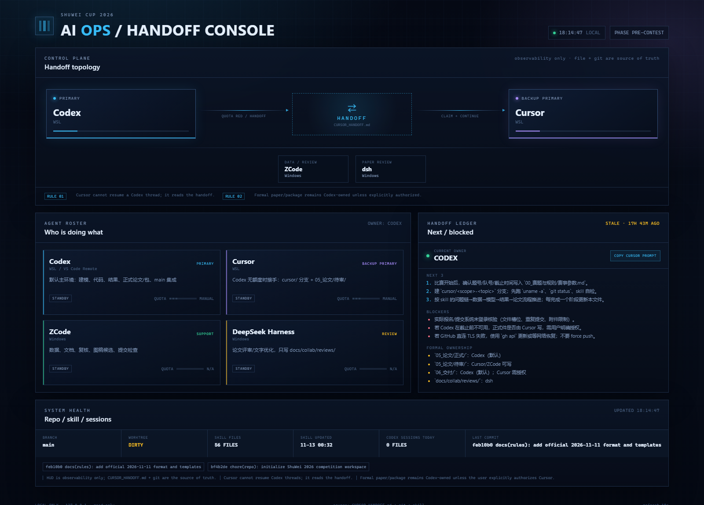

# AI Ops HUD — multi-agent handoff console



参考 `agent-hud-open` 的“状态卡 + 额度色 + 一跳回会话”思路，但这是一个**本地只读**、零依赖的简化版：

- 不安装客户端 hook，不读取密钥，不调用外部 API；
- 唯一事实源是 `docs/collab/CURSOR_HANDOFF.md` + Git + skill 文件；
- 用于比赛时一眼看到：谁在干活、handoff 下一步、阻塞、正式件所有权、分支/未提交、skill 版本。

## 启动

在 WSL：

```bash
cd ~/shuwei2026
python3 tools/agent_hud/server.py
```

打开：

```text
http://127.0.0.1:8765/
```

不依赖 Node/npm；只用 Python 标准库。Windows 浏览器可直接访问 WSL 转发端口（若没有自动转发，用 `wsl hostname -I` 查 WSL IP，或从 Windows 侧运行 `python` 读取 `\\wsl.localhost` 路径）。

## 数据源

- `tools/agent_hud/ai_flow.json`：角色、手动额度色（unknown/green/yellow/red/n/a）、flow 标签；
- `docs/collab/CURSOR_HANDOFF.md`：当前 owner、下一步、阻塞、正式件所有权；
- `git status/log`：分支、未提交、最近提交；
- skill：默认 `~/.codex/skills/mary-modeling-contest-pipeline-shuwei`，可用 `SHUWEI_SKILL_DIR` 覆盖；
- `~/.codex/sessions`：仅统计最近活动的 JSONL 数量，不读取内容。

## 手动更新

- 换 owner：改 `ai_flow.json` 的 `owner`；
- 额度红/黄/绿：改对应 agent 的 `quota`；
- 任务/阻塞：改 `CURSOR_HANDOFF.md`，面板 10 秒自动刷新；
- 不要在这里存密钥/个人数据。

## 设计边界

这不是 Agent HUD 的替代品：

- 不做实时 token/费用统计（需要读厂商凭据与本地记录）；
- 不做自动审批/消息发送；
- 不做跨机同步；
- 不改变 Codex/Cursor 的线程状态。

它的价值是把“多 AI 交接”变成一块可见的作战面板：**owner、下一步、阻塞、分支、skill 版本**一屏可见；真正的上下文仍在 handoff 文件与代码里。
